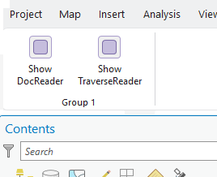
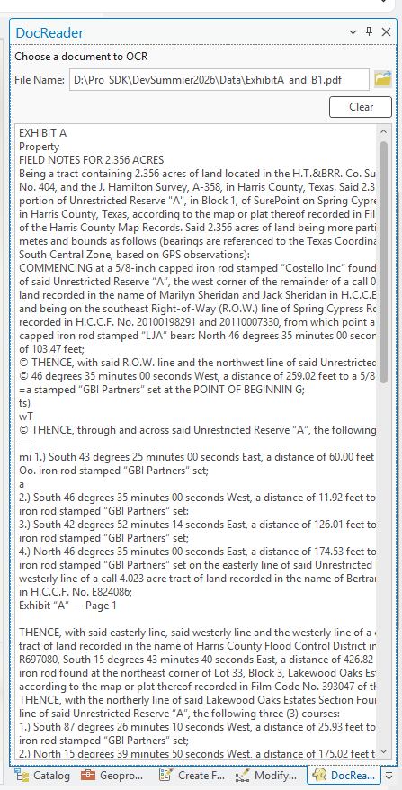
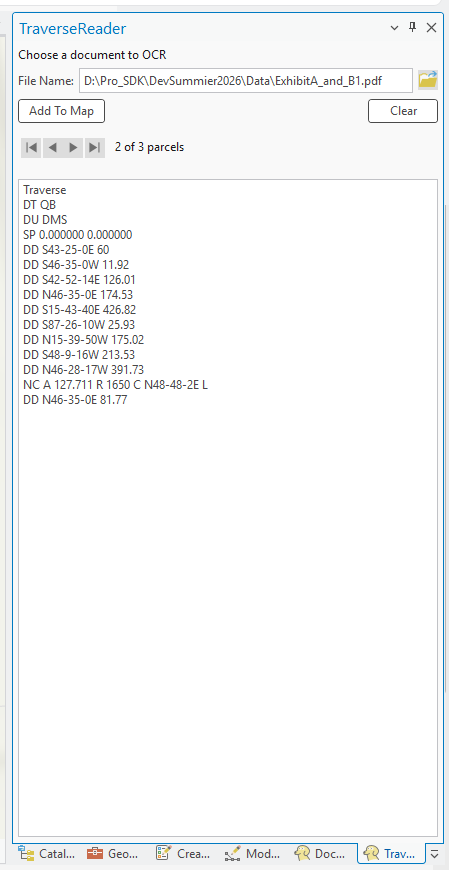

## OCRManagerSample

<!-- TODO: Write a brief abstract explaining this sample -->
Uses optical character recognition to extract document text and traverse information in dockpanes and display recognized text with its tab-separated OCR output.  
  


<a href="https://pro.arcgis.com/en/pro-app/sdk/" target="_blank">View it live</a>

<!-- TODO: Fill this section below with metadata about this sample-->
```
Language:              C#
Subject:               Editing
Contributor:           ArcGIS Pro SDK Team <arcgisprosdk@esri.com>
Organization:          Esri, https://www.esri.com
Date:                  11/01/2026
ArcGIS Pro:            3.8
Visual Studio:         2026, VS Code
Target Framework:      net10.0-windows
```

## Resources

[Community Sample Resources](https://github.com/Esri/arcgis-pro-sdk-community-samples#resources)

### Samples Data

* Sample data for ArcGIS Pro SDK Community Samples can be downloaded from the [Releases](https://github.com/Esri/arcgis-pro-sdk-community-samples/releases) page.  

## How to use the sample
<!-- TODO: Explain how this sample can be used. To use images in this section, create the image file in your sample project's screenshots folder. Use relative url to link to this image using this syntax:  -->
1. In Visual Studio click the Build menu. Then select Build Solution.
2. Click Start button to debug ArcGIS Pro.  
3. Open a project. Navigate to the Add-In tab on the ribbon.   
  
4. Open the DocReader dockpane.  Click the open button to choose a document to perform the OCR.   
Documents that are supported are *.pdf;*.tif;*.tiff;*.jpg;*.jpeg;*.png;*.bmp.  
The document text will be displayed in the bottom half of the dockpane.   
  
5. Click Clear to remove the data or choose another document.  
6. Open the TraverseReader dockpane.  Click the open button to choose a document to extract traverse information.  
Documents that are supported are*.pdf;*.tif;*.tiff;*.jpg;*.jpeg;*.png;*.bmp  
The number of traverses in the document will be shown along with a set of navigation buttons.  
The first traverse will be displayed in the bottom half of the dockpane in the ArcMap traverse file format.  
  
7. Use the navigation buttons to move to the first, previous, next or last traverse.  
8. Click "Add to Map" to add the courses of the current traverse to the map's overlay.    
  

<!-- End -->

&nbsp;&nbsp;&nbsp;&nbsp;&nbsp;&nbsp;
&nbsp;&nbsp;&nbsp;&nbsp;&nbsp;&nbsp;&nbsp;&nbsp;&nbsp;&nbsp;&nbsp;&nbsp;
[Home](https://github.com/Esri/arcgis-pro-sdk/wiki) | <a href="https://pro.arcgis.com/en/pro-app/latest/sdk/api-reference" target="_blank">API Reference</a> | [Requirements](https://github.com/Esri/arcgis-pro-sdk/wiki#requirements) | [Download](https://github.com/Esri/arcgis-pro-sdk/wiki#installing-arcgis-pro-sdk-for-net) | <a href="https://github.com/esri/arcgis-pro-sdk-community-samples" target="_blank">Samples</a>
