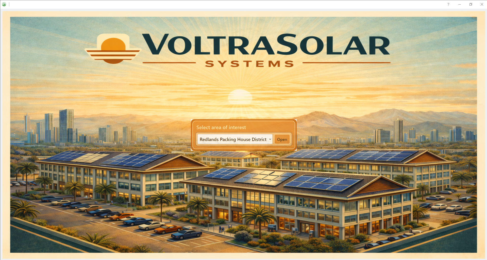
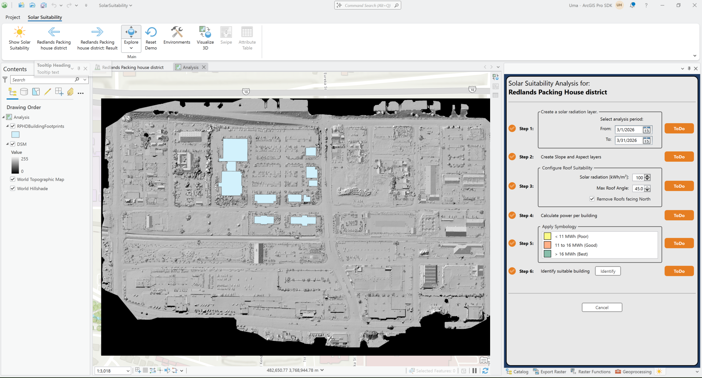
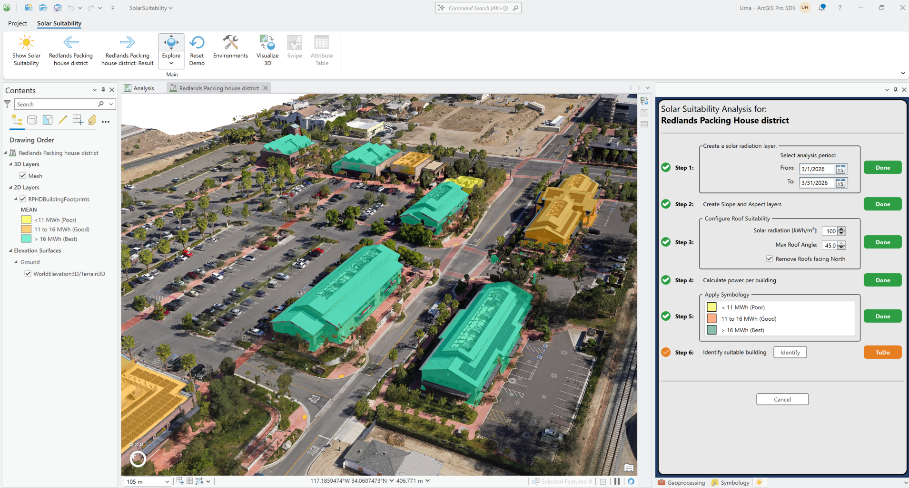
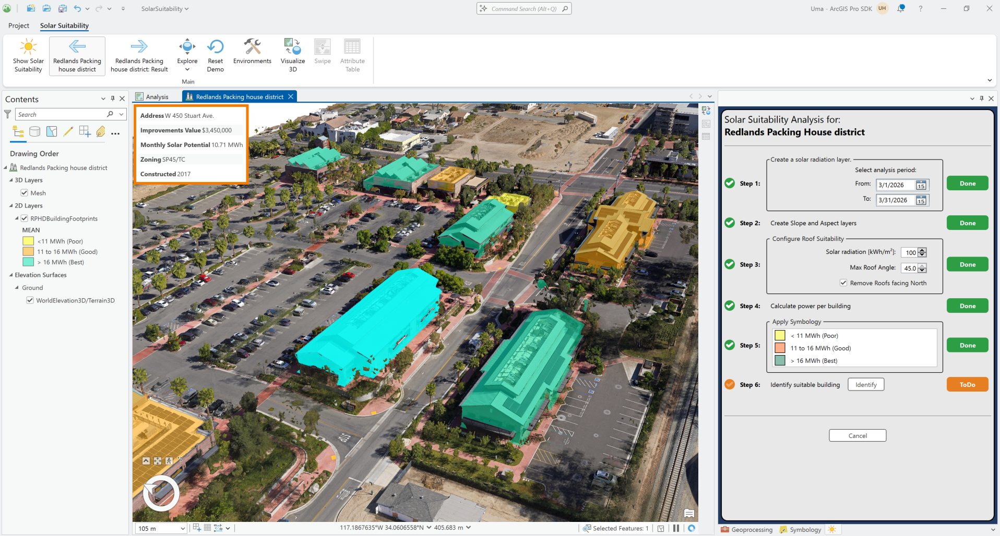
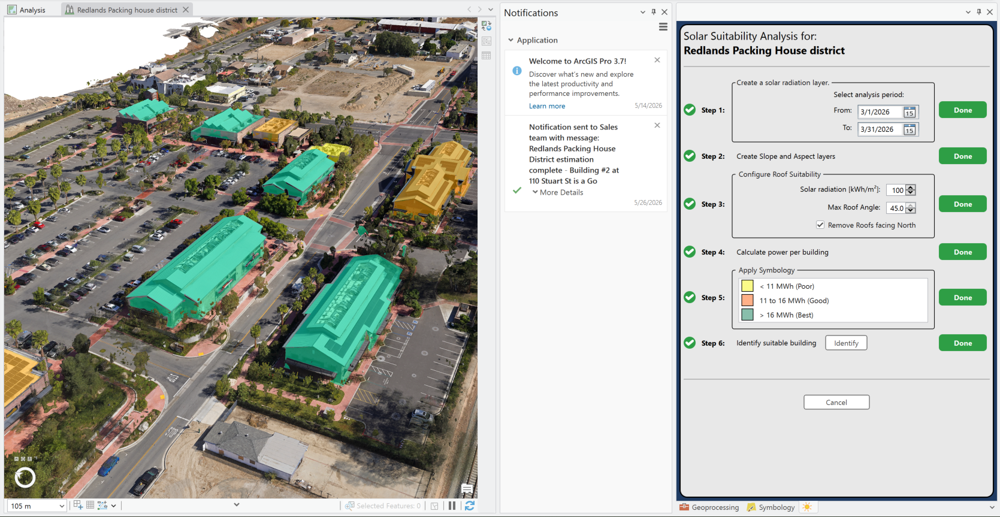

## SolarSuitability

<!-- TODO: Write a brief abstract explaining this sample -->
 Provides a solar-suitability configuration for exploring building energy potential in the Redlands Packing House district, selecting candidate properties, and visualizing results in 2D and 3D.  
   


<a href="https://pro.arcgis.com/en/pro-app/sdk/" target="_blank">View it live</a>

<!-- TODO: Fill this section below with metadata about this sample-->
```
Language:              C#
Subject:               Framework
Contributor:           ArcGIS Pro SDK Team <arcgisprosdk@esri.com>
Organization:          Esri, https://www.esri.com
Date:                  11/01/2026
ArcGIS Pro:            3.8
Visual Studio:         2026, VS Code
Target Framework:      net10.0-windows
```

## Resources

[Community Sample Resources](https://github.com/Esri/arcgis-pro-sdk-community-samples#resources)

### Samples Data

* Sample data for ArcGIS Pro SDK Community Samples can be downloaded from the [Releases](https://github.com/Esri/arcgis-pro-sdk-community-samples/releases) page.  

## How to use the sample
<!-- TODO: Explain how this sample can be used. To use images in this section, create the image file in your sample project's screenshots folder. Use relative url to link to this image using this syntax:  -->
1. Download the [Sample data](https://www.arcgis.com/sharing/rest/content/items/4a9f34c5ab4746f88b1cf26a1f48a05f/data)
 2. Unzip and place the data in your C:\data. Alternatively, modify the code to match your data location.  
 3. The project path used for this sample is 'C:\Data\SolarEstimation\SolarEstimation.aprx  
 4. In Visual studio rebuild the solution.  
 5. Run the Configuration using this commandline `"C:\Program Files\ArcGIS\Pro\bin\ArcGISPro.exe" /config:SolarSuitability`   
 6. ArcGIS Pro opens with a custom start page. This start-up page allows me to select a service area. The dropdown lists "Redlands Packing House District" as the default. Click "Open" to open the SolarEstimation.aprx project.   
   
 7. This project contains an Analysis 2D map with a "RPHDBuildingFootprints" polygon feature layer and a "DSM" raster layer. These layers are used as inputs for the solar estimation workflow. There is also a local scene called Redlands Packing House district that will be used to visualize the results.  
 8. Notice the Pro Ribbon that has been streamlined to only display the tools needed for the solar estimation analysis. Activate the Analysis map. It contains the building footprints and DSM (digital surface model) raster needed to perform the analysis.  
 9. Click the "Solar Suitability" button in the Pro UI to open the Solar Suitability dockpane. This dockpane contains the 6 step workflow to estimate the solar potential of the building footprints in the Redlands Packing House district. The workflow is implemented using geoprocessing tools that are executed in a specific order. The UI guides you through the workflow and gives you information about the progress of each step.  
    
 10. Steps 1 through 4 use various Geoprocessing tools to execute the solar estimation workflow. The geoprocessing tools are executed in a specific order and some of the tools require user input. The UI guides you through the workflow. Click through steps 1 to 4 and observe the progress bar that gives information of the specific geoprocessing tool being executed and the overall progress of the workflow. Note: In order to see the code that executes each of these steps, open the SolarSuitabilityViewModel.cs file and look at the code in the ExecuteStep1, ExecuteStep2, ExecuteStep3, ExecuteStep4 methods. Here are detailed instructions for each of the steps:  
 * Step 1: Create a solar radiation layer. This steps uses the Raster Solar Radiation tool to create the solar radiation layer. The DSM raster is used as input for this tool. The output of this tool is a raster layer that contains the solar radiation values for each cell in the DSM raster. The UI allows you to pick the start and end date for the solar radiation analysis. It is recommended to use the date range default for this sample. The result layer's renderer uses a graduated symbol renderer to display the results. If you change the date range, you will also need to update the class breaks in the renderer to see the changes in the symbology.   
 * Step 2: Create a slope and aspect layers. This steps uses the Surface Parameters tool to create the slope and aspect layers.   
 * Step 3: Configure Roof Suitability. To identify suitable rooftops for solar panels, you will consider three criteria:  
* Suitable rooftops should have a slope of 45 degrees or less, as it is difficult to install solar panels on a steep roof. The slope raster layer generated in Step 2 can be used to assess this criterion.  
* Suitable rooftops should receive at least 800 kWh/m2 of solar radiation. You can assess this criterion using your solar radiation raster layer generated in Step 1.  
* Suitable rooftops should not face north, as north-facing rooftops in the northern hemisphere receive less sunlight. The aspect raster layer generated in Step 2 can be used to evaluate this criterion.   
Note: You can use the Swipe tool on the ribbon to compare the original solar radiation raster with the new configured solar suitability raster to see how the suitability criteria have filtered the original solar radiation results.  
* Step 4: Calculate power per building. In this step the Zonal Statistics as Table tool is used to aggregate the data to determine how much solar radiation is received by each building. After this step, click the Attribute table button on the ribbon or on the mini toolbar on the map to see the RPHDBuildingFootprints attribute table. Notice the new "MEAN" field that has been added to the attribute table that contain the results of the analysis. The "Mean" field contains the average solar radiation received by each building footprint.   
11. Step 5: Visualize the results in a local scene. The local scene "Redlands Packing House district" is used to visualize the results of the analysis. Click the Visualize in 3D button to activate the local scene. Displayed in the view is a 3D Mesh of the area of interest, the Redlands Packing House District. Execute Step 5. This will standardize the symbology of the building footprint polygon layer (draped over the mesh) using a template into 3 categories –Poor, good and the best based on the solar potential.   
    
  12. Step 6: Click the Identify button to select and identify a candidate. Execute Step 6 to also send an update to the sales team about the suitability of this building. A toast notification will appear in Pro to confirm that the sales team has been notified.  
    
    
   

<!-- End -->

&nbsp;&nbsp;&nbsp;&nbsp;&nbsp;&nbsp;
&nbsp;&nbsp;&nbsp;&nbsp;&nbsp;&nbsp;&nbsp;&nbsp;&nbsp;&nbsp;&nbsp;&nbsp;
[Home](https://github.com/Esri/arcgis-pro-sdk/wiki) | <a href="https://pro.arcgis.com/en/pro-app/latest/sdk/api-reference" target="_blank">API Reference</a> | [Requirements](https://github.com/Esri/arcgis-pro-sdk/wiki#requirements) | [Download](https://github.com/Esri/arcgis-pro-sdk/wiki#installing-arcgis-pro-sdk-for-net) | <a href="https://github.com/esri/arcgis-pro-sdk-community-samples" target="_blank">Samples</a>
