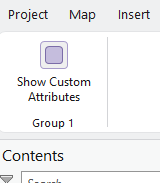
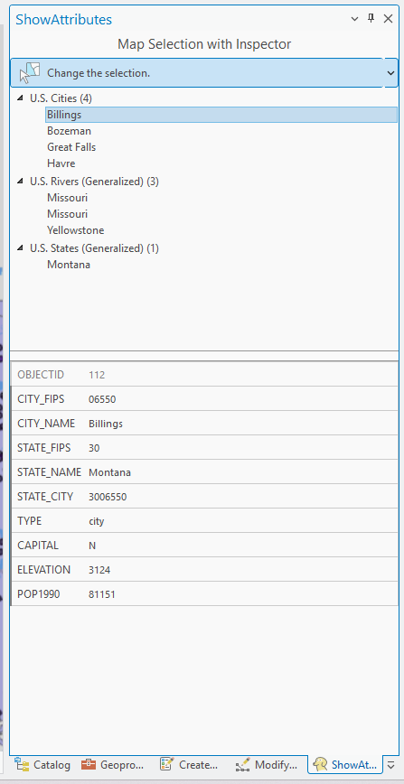
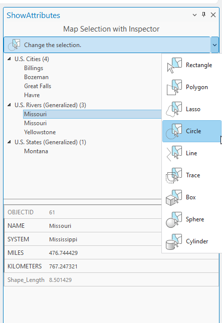

## AttributesCustomDockpane

<!-- TODO: Write a brief abstract explaining this sample -->
Provides a custom attributes dockpane that combines feature-selection controls with an embedded Inspector for viewing and editing selected features.  
  


<a href="https://pro.arcgis.com/en/pro-app/sdk/" target="_blank">View it live</a>

<!-- TODO: Fill this section below with metadata about this sample-->
```
Language:              C#
Subject:               Editing, Map Exploration
Contributor:           ArcGIS Pro SDK Team <arcgisprosdk@esri.com>
Organization:          Esri, https://www.esri.com
Date:                  11/01/2026
ArcGIS Pro:            3.8
Visual Studio:         2026, VS Code
Target Framework:      net10.0-windows
```

## Resources

[Community Sample Resources](https://github.com/Esri/arcgis-pro-sdk-community-samples#resources)

### Samples Data

* Sample data for ArcGIS Pro SDK Community Samples can be downloaded from the [Releases](https://github.com/Esri/arcgis-pro-sdk-community-samples/releases) page.  

## How to use the sample
<!-- TODO: Explain how this sample can be used. To use images in this section, create the image file in your sample project's screenshots folder. Use relative url to link to this image using this syntax:  -->
1. In Visual Studio click the Build menu. Then select Build Solution.
2. Click Start button to debug ArcGIS Pro.  
3. Open any ArcGIS Pro project. Navigate to the Add-In tab on the ribbon.   
  
4. Click the Show Custom Attributes button.  This will display the Custom Attributes dockpane.    
The SelectionToolPicker will display "Select one or more features" or "Change the selection" depending on whether a selection exists in the map. The current map selection (if any) will be displayed in the treeview.  
Highlight an item in the treeview to populate the bottom half of the dockpane with the attributes.   
  
5. Interact with the dockpane, highlighting different items in the treeview, activating the   
SelectionToolPicker to make a different selection or choosing a different selection tool from the SelectionToolPicker dropdown.   
  
6. You can also activate a different map and the dockpane will respond and display the current selection of that map.   
  

<!-- End -->

&nbsp;&nbsp;&nbsp;&nbsp;&nbsp;&nbsp;
&nbsp;&nbsp;&nbsp;&nbsp;&nbsp;&nbsp;&nbsp;&nbsp;&nbsp;&nbsp;&nbsp;&nbsp;
[Home](https://github.com/Esri/arcgis-pro-sdk/wiki) | <a href="https://pro.arcgis.com/en/pro-app/latest/sdk/api-reference" target="_blank">API Reference</a> | [Requirements](https://github.com/Esri/arcgis-pro-sdk/wiki#requirements) | [Download](https://github.com/Esri/arcgis-pro-sdk/wiki#installing-arcgis-pro-sdk-for-net) | <a href="https://github.com/esri/arcgis-pro-sdk-community-samples" target="_blank">Samples</a>
