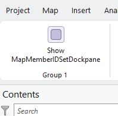
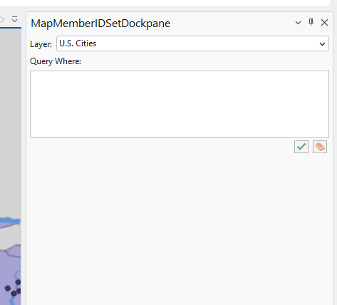
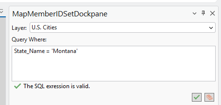
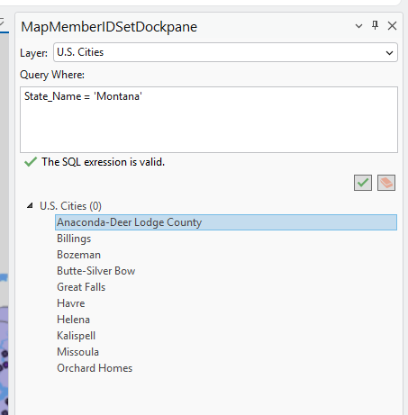

## MapMemberIDSetControl

<!-- TODO: Write a brief abstract explaining this sample -->
Hosts MapMemberIDSetControl in a dockpane to display and manage sets of feature identifiers grouped by map layer.  
  


<a href="https://pro.arcgis.com/en/pro-app/sdk/" target="_blank">View it live</a>

<!-- TODO: Fill this section below with metadata about this sample-->
```
Language:              C#
Subject:               Map Exploration
Contributor:           ArcGIS Pro SDK Team <arcgisprosdk@esri.com>
Organization:          Esri, https://www.esri.com
Date:                  11/01/2026
ArcGIS Pro:            3.8
Visual Studio:         2026, VS Code
Target Framework:      net10.0-windows
```

## Resources

[Community Sample Resources](https://github.com/Esri/arcgis-pro-sdk-community-samples#resources)

### Samples Data

* Sample data for ArcGIS Pro SDK Community Samples can be downloaded from the [Releases](https://github.com/Esri/arcgis-pro-sdk-community-samples/releases) page.  

## How to use the sample
<!-- TODO: Explain how this sample can be used. To use images in this section, create the image file in your sample project's screenshots folder. Use relative url to link to this image using this syntax:  -->
1. In Visual Studio click the Build menu. Then select Build Solution.
2. Click Start button to debug ArcGIS Pro.  
3. Open any ArcGIS Pro project. Navigate to the Add-In tab on the ribbon.   
  
4. Click the Show MapMemberIDSetDockpane button.  This will display the MapMemberIDSetDockpane dockpane.    
A combobox displays the layers in the active map.  There is also an edit box for entering an SQL where clause.   
  
5. Choose a layer from the Combobox and enter a where clause in the "Query where" edit box. Click the   
"Verify Expression" button.  
  
6. A message label is displayed indicating if the query has valid syntax or not.   
If valid, the query results are displayed in the tree view of the MapMemberIDSetControl.  
  
  

<!-- End -->

&nbsp;&nbsp;&nbsp;&nbsp;&nbsp;&nbsp;
&nbsp;&nbsp;&nbsp;&nbsp;&nbsp;&nbsp;&nbsp;&nbsp;&nbsp;&nbsp;&nbsp;&nbsp;
[Home](https://github.com/Esri/arcgis-pro-sdk/wiki) | <a href="https://pro.arcgis.com/en/pro-app/latest/sdk/api-reference" target="_blank">API Reference</a> | [Requirements](https://github.com/Esri/arcgis-pro-sdk/wiki#requirements) | [Download](https://github.com/Esri/arcgis-pro-sdk/wiki#installing-arcgis-pro-sdk-for-net) | <a href="https://github.com/esri/arcgis-pro-sdk-community-samples" target="_blank">Samples</a>
