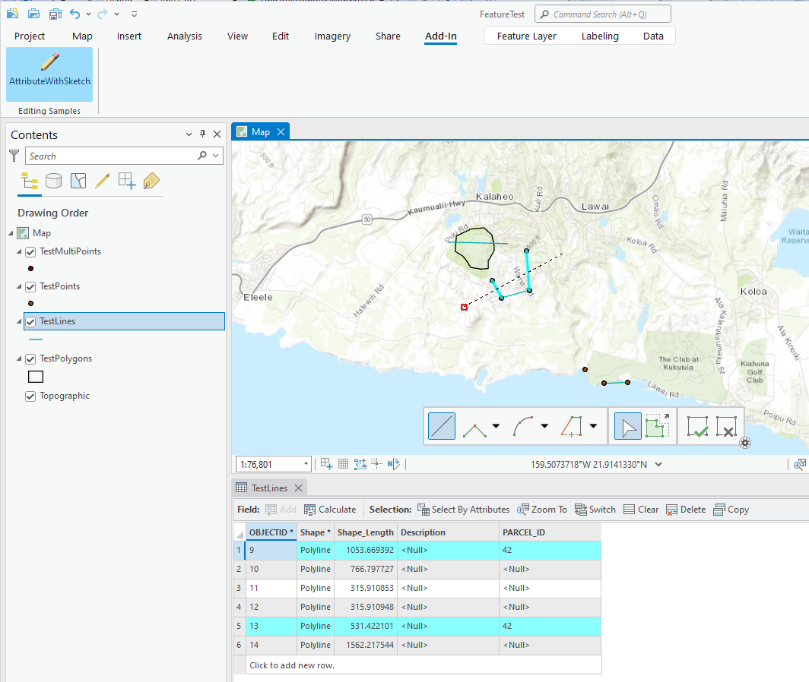

## UpdateAttributesWithSketch

<!-- TODO: Write a brief abstract explaining this sample -->
Updates attributes on features intersected by a sketch in the selected feature layer using an Inspector and an edit operation.  
  


<a href="https://pro.arcgis.com/en/pro-app/sdk/" target="_blank">View it live</a>

<!-- TODO: Fill this section below with metadata about this sample-->
```
Language:              C#
Subject:               Editing
Contributor:           ArcGIS Pro SDK Team <arcgisprosdk@esri.com>
Organization:          Esri, https://www.esri.com
Date:                  11/01/2026
ArcGIS Pro:            3.8
Visual Studio:         2026, VS Code
Target Framework:      net10.0-windows
```

## Resources

[Community Sample Resources](https://github.com/Esri/arcgis-pro-sdk-community-samples#resources)

### Samples Data

* Sample data for ArcGIS Pro SDK Community Samples can be downloaded from the [Releases](https://github.com/Esri/arcgis-pro-sdk-community-samples/releases) page.  

## How to use the sample
<!-- TODO: Explain how this sample can be used. To use images in this section, create the image file in your sample project's screenshots folder. Use relative url to link to this image using this syntax:  -->
1. Examine the code within AttributeWithSketch.cs.
2. This code finds a field named "PARCEL_ID" and replaces the value with "42".  
3. Build or debug start the sample through Visual Studio.  
4. The project used for this sample is 'C:\Data\FeatureTest\FeatureTest.aprx'  
5. Select the layer in the table of contents who's attributes you wish to update with this tool. Create a field called "PARCEL_ID" in this layer.  
6. Select the "AttributeWithSketch" tool in the Add-In Tab.  
7. Sketch a line across features in the selected layer.  
8. Features that intersect the sketch will have their attributes in the PARCEL_ID field updated.  
      
  

<!-- End -->

&nbsp;&nbsp;&nbsp;&nbsp;&nbsp;&nbsp;
&nbsp;&nbsp;&nbsp;&nbsp;&nbsp;&nbsp;&nbsp;&nbsp;&nbsp;&nbsp;&nbsp;&nbsp;
[Home](https://github.com/Esri/arcgis-pro-sdk/wiki) | <a href="https://pro.arcgis.com/en/pro-app/latest/sdk/api-reference" target="_blank">API Reference</a> | [Requirements](https://github.com/Esri/arcgis-pro-sdk/wiki#requirements) | [Download](https://github.com/Esri/arcgis-pro-sdk/wiki#installing-arcgis-pro-sdk-for-net) | <a href="https://github.com/esri/arcgis-pro-sdk-community-samples" target="_blank">Samples</a>
