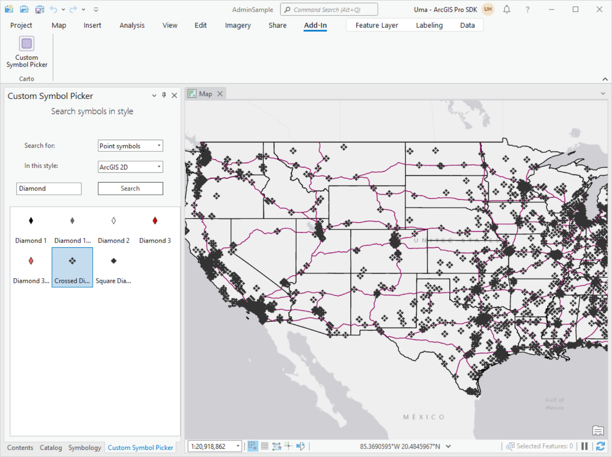

## CustomSymbolPicker

<!-- TODO: Write a brief abstract explaining this sample -->
Searches project styles in a custom symbol-gallery dockpane and applies the selected symbol to the feature layer selected in the Contents pane.  
  


<a href="https://pro.arcgis.com/en/pro-app/sdk/" target="_blank">View it live</a>

<!-- TODO: Fill this section below with metadata about this sample-->
```
Language:              C#
Subject:               Map Authoring
Contributor:           ArcGIS Pro SDK Team <arcgisprosdk@esri.com>
Organization:          Esri, https://www.esri.com
Date:                  11/01/2026
ArcGIS Pro:            3.8
Visual Studio:         2026, VS Code
Target Framework:      net10.0-windows
```

## Resources

[Community Sample Resources](https://github.com/Esri/arcgis-pro-sdk-community-samples#resources)

### Samples Data

* Sample data for ArcGIS Pro SDK Community Samples can be downloaded from the [Releases](https://github.com/Esri/arcgis-pro-sdk-community-samples/releases) page.  

## How to use the sample
<!-- TODO: Explain how this sample can be used. To use images in this section, create the image file in your sample project's screenshots folder. Use relative url to link to this image using this syntax:  -->
1. In Visual Studio click the Build menu. Then select Build Solution.
2. Launch the debugger to open ArcGIS Pro.  
4. Either create a new blank project OR open an existing project.  
5. Make sure the project you are working with has a map or scene with feature layer (point, line or polygon).  
6. Click on the Add-In tab.  
7. Click on the Custom Symbol Picker button in the Carto group.  
8. The Custom Symbol Picker dock pane will open up.  
9. Select the type of symbol to search for (Point, Line, Polygon).  
10. Select the style to search - the drop-down shows all the styles in the current project.  
11. Type in a search term - multiple search terms can be separated with a space. For example: "red circle" will return results for "red AND circle".  
12. Either hit ENTER or click on the Search button.  
13. Symbol gallery will be populated with search results.  
14. Click on a feature layer in Contents pane for which the symbol has to be updated.  
15. Click on a symbol in the Custom Symbol Picker gallery - this will update the symbol for the feature layer currently selected in Contents pane.  
  
  

<!-- End -->

&nbsp;&nbsp;&nbsp;&nbsp;&nbsp;&nbsp;
&nbsp;&nbsp;&nbsp;&nbsp;&nbsp;&nbsp;&nbsp;&nbsp;&nbsp;&nbsp;&nbsp;&nbsp;
[Home](https://github.com/Esri/arcgis-pro-sdk/wiki) | <a href="https://pro.arcgis.com/en/pro-app/latest/sdk/api-reference" target="_blank">API Reference</a> | [Requirements](https://github.com/Esri/arcgis-pro-sdk/wiki#requirements) | [Download](https://github.com/Esri/arcgis-pro-sdk/wiki#installing-arcgis-pro-sdk-for-net) | <a href="https://github.com/esri/arcgis-pro-sdk-community-samples" target="_blank">Samples</a>
