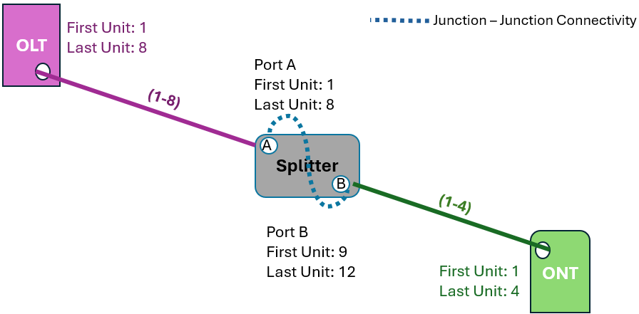
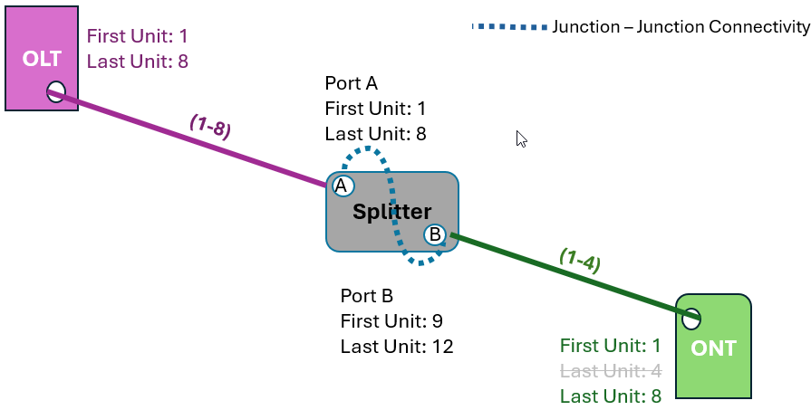
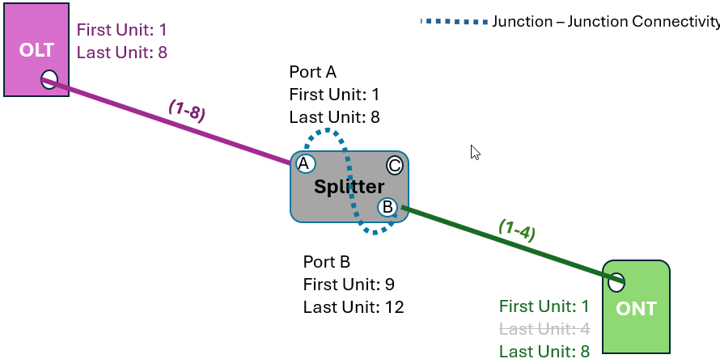

## CircuitManagement

<!-- TODO: Write a brief abstract explaining this sample -->
Builds and manages telecom circuits and equipment in a mobile-geodatabase utility network using a standalone CoreHost application.  
The sample creates an optical line terminal (OLT), an optical network terminal (ONT), a splitter, ports, fiber cables, and fiber strands. It establishes containment and connectivity associations, validates the network topology, and creates and verifies physical circuits.  
In addition, the sample demonstrates equipment management by querying and reserving unit identifiers on a splitter and resizing an ONT port group.  
  


<a href="https://pro.arcgis.com/en/pro-app/sdk/" target="_blank">View it live</a>

<!-- TODO: Fill this section below with metadata about this sample-->
```
Language:              C#
Subject:               Console
Contributor:           ArcGIS Pro SDK Team <arcgisprosdk@esri.com>
Organization:          Esri, https://www.esri.com
Date:                  11/01/2026
ArcGIS Pro:            3.8
Visual Studio:         2026, VS Code
Target Framework:      .NET 10.0
```

## Resources

[Community Sample Resources](https://github.com/Esri/arcgis-pro-sdk-community-samples#resources)

### Samples Data

* Sample data for ArcGIS Pro SDK Community Samples can be downloaded from the [Releases](https://github.com/Esri/arcgis-pro-sdk-community-samples/releases) page.  

## How to use the sample
<!-- TODO: Explain how this sample can be used. To use images in this section, create the image file in your sample project's screenshots folder. Use relative url to link to this image using this syntax:  -->
1. Install and license ArcGIS Pro 3.8 and install the .NET 10 SDK. Use Visual Studio 2026 or VS Code with C# support to build the project.
2. Get the telecom utility network data from the [ArcGIS Pro SDK community samples releases](https://github.com/Esri/arcgis-pro-sdk-community-samples/releases) and place the working copy at **C:\Data\TelecomUtilityNetwork.geodatabase**.  
3. Open `CircuitManagement.slnx` in Visual Studio, or open `CircuitManagement.csproj` in your development environment. Build the project and run the `CircuitManagement` console application.  
4. The console reports the ObjectIDs of the devices, ports, cables, and fiber strands as they are created. The application then creates associations, validates the network topology, creates and verifies two physical circuits, reserves splitter units, and resizes the ONT port group.  
5. To inspect the persisted results, open ArcGIS Pro after the application finishes and add the utility network from the working mobile geodatabase to a map.  
  
### Circuit management  
  
The sample opens the utility network in the mobile geodatabase and obtains the telecom domain network named `Telco`. It reads the domain network's circuit properties, wavelength schemes, color schemes, color sets, and combine and divide policies.  
It creates the following network:  
- An OLT with port units 1 through 8.  
- A splitter with port group A covering units 1 through 8 and port group B covering units 9 through 12. A junction-junction connectivity association connects the two port groups.  
- An ONT with port units 1 through 4.  
- A fiber cable containing strand units 1 through 8 between the OLT and splitter, and a second cable containing strand units 1 through 4 between the splitter and ONT.  
Containment associations place the ports inside their devices and the fiber strands inside their cables. Junction-edge object connectivity associations connect the ports to the fiber strands.  
  
  
After validating the network topology, the sample uses `CircuitManager` to create two physical circuits:  
- `OLT_ONT_1_4_SectionedCircuit`: a sectioned circuit from OLT units 1 through 4 to the ONT through the splitter, with two sections connected in series.  
- `OLT_Splitter_5_8_Circuit`: a nonsectioned circuit from OLT units 5 through 8 to splitter port group A units 5 through 8. The sample also sets a user-defined circuit attribute.  
  
Both circuits are verified with `ForceVerify` and `SynthesizeGeometries` enabled.  
### Equipment management  
The sample uses `UnitIdentifierManager` to query the splitter's unit identifiers, reserve units 15 through 20 on the splitter, and query the updated unit information. It also resizes the ONT port group by changing its last unit from 4 to 8.  
The following diagram highlights the ONT port group after resizing. The fiber strand ranges remain unchanged.  
  
  
The final diagram includes an additional splitter position labeled C to illustrate the equipment reservation scenario. The code reserves unit identifiers 15 through 20 on the splitter; it does not create an additional port object at C.  
  
  
  
### Using other data  
The sample is configured for the supplied mobile geodatabase. It expects a `Telco` telecom domain network, the `TelcoDevice`, `TelcoLine`, `TelcoJunctionObject`, and `TelcoEdgeObject` datasets, and the asset groups, asset types, fields, association rules, and circuit configuration used in `CircuitManagement.cs`.  
To use another dataset, update the hard-coded schema names, unit ranges, color scheme, circuit attributes, and geometries as needed. Changing only the geodatabase path is not sufficient unless the replacement data has the same configuration.  
  

<!-- End -->

&nbsp;&nbsp;&nbsp;&nbsp;&nbsp;&nbsp;
&nbsp;&nbsp;&nbsp;&nbsp;&nbsp;&nbsp;&nbsp;&nbsp;&nbsp;&nbsp;&nbsp;&nbsp;
[Home](https://github.com/Esri/arcgis-pro-sdk/wiki) | <a href="https://pro.arcgis.com/en/pro-app/latest/sdk/api-reference" target="_blank">API Reference</a> | [Requirements](https://github.com/Esri/arcgis-pro-sdk/wiki#requirements) | [Download](https://github.com/Esri/arcgis-pro-sdk/wiki#installing-arcgis-pro-sdk-for-net) | <a href="https://github.com/esri/arcgis-pro-sdk-community-samples" target="_blank">Samples</a>
